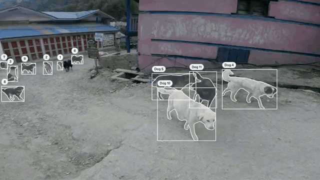
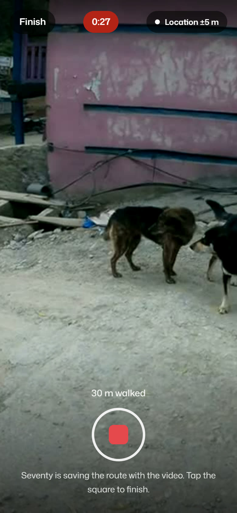
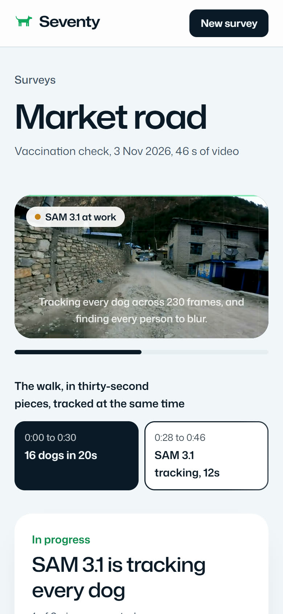
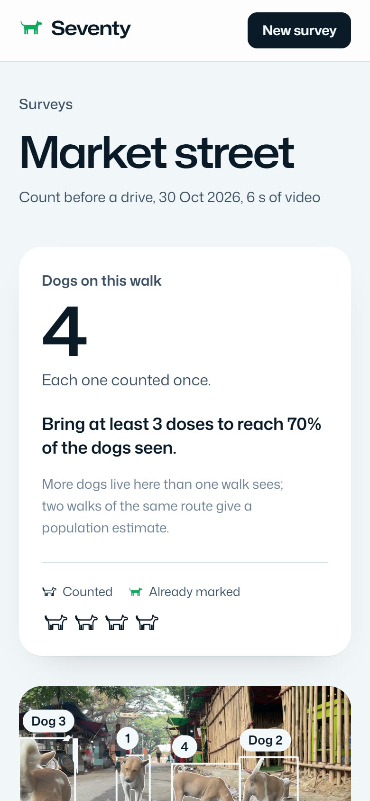
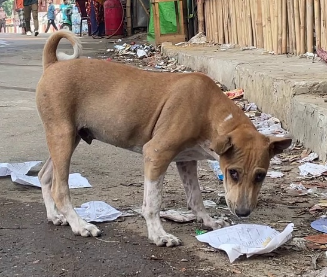
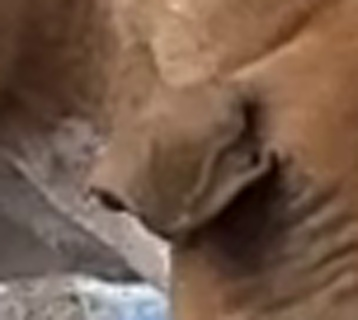
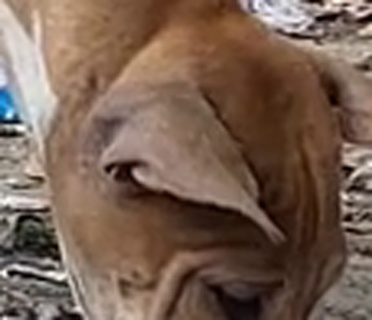
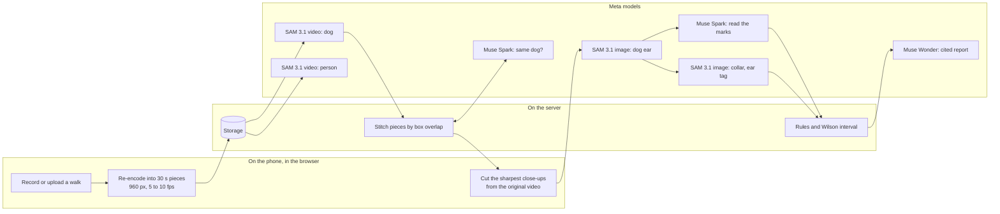

# Seventy

Rabies hides in the dogs a vaccination drive missed. Seventy finds them.

[Live app](https://seventy-world.vercel.app) | [A finished survey](https://seventy-world.vercel.app/app/demo) | [Run the pipeline on a sample clip](https://seventy-world.vercel.app/app/new?sample=1) | [Frame-by-frame evaluation](eval/)

<p align="center">
  
</p>
<p align="center"><sub>Real SAM 3.1 output on a walk through a mountain village, drawn by Seventy's replay in the browser. Each dog keeps one number for as long as it is in view.</sub></p>

A surveyor films a street with any phone. Seventy counts every dog once, reads each dog's vaccination mark, and tells the team whether the street reached the 70% of dogs vaccinated that stops rabies. Then it shows where the unvaccinated dogs are, so the team goes back to those streets and no others. Every number on the page opens to the dogs behind it.

Built by one person for the Meta Global AI Developer Hackathon 2026, Indie track, theme Build for Your World. The seeing, reading and writing are done by three Meta models: SAM 3.1, Muse Spark and Muse Wonder.

## A two-minute tour

- Open [a finished survey](https://seventy-world.vercel.app/app/demo) and press Play to watch SAM 3.1 count a pack of 13 dogs, each once.
- Follow [one dog through every model call](#one-dog-start-to-finish), with Muse Spark's real reading.
- Check [the measured results](#measured-results) against the [hand-scored frames](eval/).
- Run the whole pipeline yourself on [a six-second clip](https://seventy-world.vercel.app/app/new?sample=1). It takes about two minutes.

## The problem

Rabies kills tens of thousands of people every year. Four in ten are children, and almost every case starts with a dog bite. Once symptoms begin it is almost always fatal, and every one of those deaths can be prevented with a vaccine ([WHO, 2026](https://www.who.int/news-room/fact-sheets/detail/rabies)).

The fix is known. Vaccinate 70 of every 100 dogs in an area and the virus runs out of dogs to spread through. WHO and its partners have set 2030 as the year human deaths from dog rabies should end ([Zero by 30](https://www.who.int/publications/m/item/zero-by-30-the-global-strategic-plan-to-prevent-humandeaths-from-dog-transmitted-rabies-by-2030)).

The weak step is checking. After a drive, surveyors walk the streets and tally marked and unmarked dogs on paper. The problems with that tally are well documented:

- One 2025 campaign, measured three standard ways, came out at 47%, 32% and 19% coverage ([Frontiers in Microbiology, 2025](https://www.frontiersin.org/journals/microbiology/articles/10.3389/fmicb.2025.1696281/full)).
- Street counts miss puppies, which are often too young to have been vaccinated, so coverage reads about 10% too high ([Frontiers in Veterinary Science, 2017](https://www.frontiersin.org/journals/veterinary-science/articles/10.3389/fvets.2017.00033/full)).
- Two observers agree on a vaccination mark's colour barely better than chance ([Bothma et al.](https://pubmed.ncbi.nlm.nih.gov/26092723/)).
- The result is one number on a sheet. Nobody can check it afterwards.

So a drive that missed 70% looks exactly like one that reached it, until someone is bitten.

Cities already pay to solve the counting half of this. In October 2026 San Antonio paid about $99,000 for an AI count of its roaming dogs, filmed from city vehicles, after volunteer counts came back unreliable ([KSAT](https://www.ksat.com/news/local/2026/10/28/researchers-use-cell-phones-and-ai-to-count-loose-dogs-in-san-antonio/), [Southwest Research Institute](https://www.swri.org/what-we-do/internal-research-development/2024/automotive-transportation/city-of-san-antonio-rd-league-computer-vision-unrestrained-dog-census-10-r633004)). Rabies programmes in Asia and Africa have the same question and a fraction of that budget. Seventy answers it, vaccination coverage included, from the walk their teams already make, for about $2 of model time.

## What one walk gives the team

| The team gets | How |
|---|---|
| Every dog counted once | SAM 3.1 tracks each dog through the video from the single word "dog". A long walk is split into pieces that overlap by two seconds and are joined by box overlap, so a dog crossing a boundary keeps its number. |
| Each dog's mark, read | SAM 3.1 finds and enlarges each dog's ears. Muse Spark reads paint, collars, ear tags and sterilization ear notches into fixed fields. For collars and ear tags, SAM 3.1 looks for the mark itself, and the two models have to agree. |
| Coverage with an honest margin | A Wilson 95% interval against the 70% line. Dogs too blurred to read are left out, never guessed. Below ten readable dogs, Seventy gives no percentage at all. |
| The doses to bring | From the count, before a drive starts. |
| Where to go back | A walk recorded in Seventy saves the phone's GPS route. Each dog sits on a map where it was first seen, the dogs still to vaccinate are grouped into places with walking directions, and the list goes to the team's chat in one tap. |
| A report for the office | Muse Wonder writes one page: the result, what to do tomorrow, and the WHO and national rules behind it, found by web search and cited. |
| Footage that is safe to share | Every person is pixelated inside their own SAM 3.1 outline, frame by frame. Nobody is counted or identified. |

<p align="center">
  
  
  
</p>
<p align="center"><sub>Real screens from the app on a phone: recording a walk with its route, the live screen while SAM 3.1 tracks two pieces at once, and a finished survey. The first two come from a test walk with a simulated GPS route.</sub></p>

## Measured results

Four street videos from four very different places, checked by hand. Every dog in each video was counted without looking at Seventy's answer, then 28 frames were scored one dog at a time against SAM 3.1's boxes.

Seventy found all 28 dogs and counted each one once. Every one of the 159 boxes SAM 3.1 drew in the checked frames was on a real dog.

| Video | Place | Dogs by hand | Seventy | What makes it hard |
|---|---|---:|---:|---|
| Mountain village square | A mountain village at dusk, 20 s | 13 | 13 | A pack crossing the square around the camera |
| Seaside promenade | A seaside town, 22 s | 9 | 9 | A dark dog curled up far across the lawn, picked up in the last second |
| Market street | A city market, 6 s | 4 | 4 | Dogs close to the lens with a crowd behind them |
| Village lane | A village in the tropics, 16 s | 2 | 2 | Two dogs and a child walking past |
| Total | | 28 | 28 | |

| Video | Frames checked | Dog sightings | Boxed by SAM 3.1 | False alarms |
|---|---:|---:|---:|---:|
| Mountain village square | 11 | 89 | 89 | 0 |
| Seaside promenade | 9 | 50 | 46 | 0 |
| Market street | 4 | 16 | 16 | 0 |
| Village lane | 4 | 8 | 8 | 0 |
| All four | 28 | 163 | 159 | 0 |

The four sightings without a box are all the same dog, the one curled up dark against the promenade lawn, about 40 pixels long in a 1080 by 1920 frame. SAM 3.1 picks it up at 21.9 seconds, so it is counted. The hand labels, SAM's boxes, the scored frames and the scoring script are in [`eval/`](eval/), and CI scores them again on every push. You can [see every checked frame](web/public/eval/mountain-village.jpg) with SAM's boxes drawn on it.

Three things from the runs that show how the rules behave:

- Repeats. When a track started after another ended, Muse Spark compared the two dogs' close-ups. It checked 5 such pairs across the four videos and merged none, and the hand count agrees: no dog was counted twice.
- Two models disagreeing. On one mountain dog, SAM 3.1 took dark eyebrow spots for an ear tag. Muse Spark saw no tag. Under Seventy's rules neither answer counts for that dog, so one model's mistake can't become the result.
- The smallest mark. A municipal ear tag about 25 pixels across sits on a dog far down the promenade. SAM 3.1's enlarged ear makes it visible. Muse Spark called the ear "too blurry to judge tag or notch" and the rules did not guess.

## How the Meta models are used

Seven jobs for three models. The calls are from the mountain village walk: 20 seconds, 13 dogs.

| Model | Mode | Asked | Job | Calls | Without it |
|---|---|---|---|---:|---|
| SAM 3.1 | Video tracking | "dog" | Follows every dog through every frame. This is the count. | 1 job, 138 frames, 57.9 s | Dogs counted twice, or missed |
| SAM 3.1 | Video tracking | "person" | Finds people only to pixelate them inside their outline | 1 job, 20.1 s | Footage nobody should share |
| SAM 3.1 | Image segmentation | "dog ear" | Finds the ears on each dog's two best close-ups, enlarged for reading | 26 | Small tags and notches stay unreadable |
| Muse Spark | Vision, structured output | A fixed JSON schema | Reads paint, collar, ear tag, ear notch, puppy, lead, view quality, confidence and a reason | 13 | Marks read differently by every reader |
| SAM 3.1 | Image segmentation | "collar", "ear tag" | Looks for the mark itself, as a second opinion on Muse Spark | 26 | One model's mistake becomes the result |
| Muse Spark | Vision, comparison | Two dogs' close-ups | Same dog, different, or unsure, when a track starts after another ended | 3 | The same dog counted twice |
| Muse Wonder | Reasoning with web search | The walk's numbers | Writes the report, with the WHO and national rules it uses, cited | 1 | Numbers without a decision |

The browser uses Meta's SAM client libraries too: `@meta-sam/parser` reads SAM's output, and `@meta-sam/graphics` and `@meta-sam/video` draw the outlines, numbers and blur on every frame of the replay.

## One dog, start to finish

Dog 4 from the market street walk, exactly as its record is stored.

<p>
  
  
  
</p>

1. SAM 3.1 tracked "dog" over all 62 frames of the walk and followed this dog from the first second to the last, with a mean confidence of 0.96. The three other dogs in the frame got their own numbers.
2. The browser went back to the original full-resolution video and cut the three sharpest views of Dog 4, at 0.7, 1.7 and 2.9 seconds, ranked by the variance of the Laplacian.
3. SAM 3.1 found "dog ear" on the two best close-ups, and Seventy enlarged both.
4. Muse Spark read the close-ups and ears in 7.3 seconds and returned this:

```json
{
  "is_dog": true,
  "paint": { "status": "absent", "color": null, "location": null },
  "collar": { "status": "absent", "color": null },
  "ear_tag": { "status": "absent", "color": null },
  "ear_notch": { "status": "absent", "side": null },
  "life_stage": "adult",
  "lead": { "status": "absent" },
  "coat": "tan with white lower legs chest and curled tail with white tip",
  "view_quality": "good",
  "confidence": 0.85,
  "reason": "Tan free-roaming dog with white legs shows no paint, collar, ear tag or ear notch in clear body views and ear close-ups."
}
```

5. SAM 3.1 looked for "collar" on the best close-up and "ear tag" on the enlarged ear, and found neither. The two models agree.
6. Seventy's rules: a good view, no mark, and two models in agreement, so Dog 4 is not marked. It counts against coverage, goes on the dose list, and on a recorded walk it goes on the map of where to go back.

The whole market walk, four dogs and a crowd blurred, cost $0.09 of model time.

## What runs where



The parts of the design that matter most:

- The phone does the heavy video work. [Mediabunny](https://mediabunny.dev) re-encodes the walk with WebCodecs into 30-second pieces at 960 px and 5 to 10 frames a second, so a minute of 1080p video uploads as about 5 to 9 MB. The original never leaves the phone, and the close-ups are cut from it later at full resolution.
- The server holds no long jobs. Each time the page checks in, the server moves the walk on by one short step: start SAM jobs, collect their output, stitch, read the next few dogs. The pieces of a long walk are tracked in parallel, and the live screen shows each one as it lands.
- Stitching (`web/src/lib/tracks.ts`): objects in each two-second overlap are matched by mean box IoU of 0.35 or more, best matches first. A track shorter than 0.6 seconds counts only when SAM's confidence is 0.6 or higher.
- The decisions live in plain, tested code, not in a prompt (`web/src/lib/marks.ts`, `web/src/lib/stats.ts`): the clear-view rule, two-model agreement, the Wilson interval, the ten-dog minimum, and doses as 70% of the count rounded up.
- Route maths (`web/src/lib/route.ts`): GPS fixes worse than 35 m, or that would mean moving faster than 4 m/s, are dropped. Each dog's position is interpolated at the second it was first seen. Places to go back to are dogs within 40 m of each other, grouped in walking order. On the map, pins that would overlap are clustered by distance on screen and regrouped at every zoom.
- Every model call is logged with its stage, frames or tokens, time and cost, so each survey shows what it cost. A per-workspace daily spend cap (`DAILY_SPEND_CAP_USD`) keeps a public demo from running up a bill.

Stack: Next.js 16 and React 19 on Vercel, Supabase for the database and storage, Mediabunny for video in the browser, MapLibre with OpenFreeMap tiles for the map.

## Cost and time

The mountain village walk, from its usage log:

| Stage | Model | Calls | Model time | Cost |
|---|---|---:|---:|---:|
| Track every dog | SAM 3.1 | 1 job, 138 frames | 57.9 s | $0.028 |
| Find people to blur | SAM 3.1 | 1 job, 138 frames | 20.1 s | $0.028 |
| Find the ears | SAM 3.1 | 26 | | $0.065 |
| Read every mark | Muse Spark | 13, 27,464 tokens | 80.3 s | $0.067 |
| Second opinion on marks | SAM 3.1 | 26 | 23.5 s | $0.065 |
| Check for repeats | Muse Spark | 3, 2,952 tokens | 14.3 s | $0.008 |
| Write the report | Muse Wonder | 1, 17,629 tokens | | $0.121 |
| All stages | | 71 | | $0.38 |

All four sample videos together cost $0.65 before reports, and each report adds $0.12 to $0.55, depending on how much it searches. With the reports, the four surveys took 147 model calls. A ten-minute walk at five frames a second comes to about $2: $1.28 to track dogs and people, about $0.015 a dog for readings, and the report. SAM 3.1 tracked each sample in 30 to 75 seconds.

## Privacy and safety

- SAM 3.1 looks for people only to pixelate them inside their own outline, frame by frame. Nobody is counted, named or identified, and no person is matched across walks, in line with Meta's acceptable use policy.
- The original video stays on the phone. Only a five-frames-a-second copy and the dogs' close-ups are uploaded.
- Seventy measures dog vaccination coverage for programme teams. It gives no medical advice.
- It never guesses. A dog too blurred to read is "can't tell" and is left out of the coverage. When the two models disagree, neither answer counts. With fewer than ten readable dogs there is no percentage.
- Location is saved only for walks recorded in Seventy, and it is the phone's own route.

## Who uses it

| Team | Their question | What one walk gives them |
|---|---|---|
| Rabies vaccination programmes | Did this area reach 70%? | Coverage with an honest margin, every dog's mark as evidence, and a map of where the missed dogs are |
| Dog sterilization programmes | What share of the dogs here is sterilized? | The same walk read for the ear notch, with every unclear ear left out rather than guessed |
| City animal services | How many roaming dogs, and where? | Every dog counted once and placed along the route, with owned dogs on a lead set apart |

The same check scales from one surveyor on one morning, to every area of a city drive checked within three days, to every district of a country measured the same way, so a ministry or a funder can open any number and see the dogs behind it.

## Try it

- Open a finished survey: [the mountain village square](https://seventy-world.vercel.app/app/demo). Press Play to watch SAM 3.1's tracks with the people blurred, then open any dog to see its close-ups and what was read on it.
- Run the whole pipeline live on a six-second road clip: [open the sample](https://seventy-world.vercel.app/app/new?sample=1) and press Start counting. It takes about two minutes and costs a few cents.
- On a phone, open [a new survey](https://seventy-world.vercel.app/app/new) and choose Record a walk. Allow the camera and location, film a street with dogs, and the results come with a map.

## Run it yourself

Needs Node 22 or later, a Supabase project and a Meta Model API key. The offline tools in `worker/` also need Python 3.12 and ffmpeg.

```bash
cd web
cp ../.env.example .env.local   # MODEL_API_KEY, NEXT_PUBLIC_SUPABASE_URL, NEXT_PUBLIC_SUPABASE_PUBLISHABLE_KEY, SUPABASE_SECRET_KEY
npm install
npm run dev                     # http://localhost:3000
```

Apply the SQL files in `supabase/migrations/` to the Supabase project, in order.

To prepare a walk offline and load it as a survey:

```bash
bash worker/tools/prepare_sample.sh walk.mp4 out/walk 10
python worker/tools/reid.py out/walk
cd web && npx tsx scripts/seed-walk.ts ../out/walk --title "Village lane" --mode plan
```

## Tests

```bash
cd web
npm test            # statistics, mark rules, second opinions, track stitching, route maths
npm run lint
npm run typecheck
cd .. && python eval/score.py   # SAM 3.1 against the hand labels
```

34 unit tests cover the counting, stitching, statistics, mark rules and route maths. CI runs all of it on every push, and fails if the published evaluation numbers drift from the labels.

## Repo map

- `web/` is the Next.js app.
  - `src/lib/server/` is the pipeline: SAM jobs, stitching, readings, second opinions, repeat checks, the report.
  - `src/lib/stats.ts` has the Wilson interval, coverage status and walk statistics.
  - `src/lib/tracks.ts` stitches tracks across pieces.
  - `src/lib/marks.ts` has the mark rules.
  - `src/lib/route.ts` has the GPS route maths.
  - `src/lib/client/video.ts` does the in-browser video work: probing, re-encoding pieces, cutting close-ups.
  - `src/app/app/new/RecordWalk.tsx` is the in-app recorder.
  - `src/components/WalkReplay.tsx` draws the replay, with labels and blur on every frame.
  - `src/components/WalkMap.tsx` draws the go-back map.
- `eval/` is the frame-by-frame check of SAM 3.1's boxes: hand labels, SAM's boxes and the scoring script.
- `worker/` has Python tools for preparing sample walks offline.
- `supabase/migrations/` is the database schema.

## What comes next

Uploading later when the signal comes back. The app in the languages surveyors speak. Team accounts, with a manager's laptop and five surveyors' phones on one programme. Every area's latest coverage on one district map. Two walks of the same route matched dog by dog for a population estimate. A field trial next to a standard survey, on the same streets, published in full.

## Sources

- [WHO rabies fact sheet, 2026](https://www.who.int/news-room/fact-sheets/detail/rabies)
- [Zero by 30: the global strategic plan to end human deaths from dog-mediated rabies by 2030](https://www.who.int/publications/m/item/zero-by-30-the-global-strategic-plan-to-prevent-humandeaths-from-dog-transmitted-rabies-by-2030)
- [Three ways to measure one campaign's coverage, Frontiers in Microbiology, 2025](https://www.frontiersin.org/journals/microbiology/articles/10.3389/fmicb.2025.1696281/full)
- [Comparing coverage surveys, and the puppies street counts miss, Frontiers in Veterinary Science, 2017](https://www.frontiersin.org/journals/veterinary-science/articles/10.3389/fvets.2017.00033/full)
- [Short-term marking of dogs for rabies control, Bothma et al.](https://pubmed.ncbi.nlm.nih.gov/26092723/)
- [San Antonio's AI count of loose dogs, KSAT, 28 October 2026](https://www.ksat.com/news/local/2026/10/28/researchers-use-cell-phones-and-ai-to-count-loose-dogs-in-san-antonio/)
- [The San Antonio unrestrained dog census, Southwest Research Institute](https://www.swri.org/what-we-do/internal-research-development/2024/automotive-transportation/city-of-san-antonio-rd-league-computer-vision-unrestrained-dog-census-10-r633004)

## Footage and photographs

The street videos are from Pexels and used under the Pexels License. The photographs on the landing page are from Pexels and Unsplash, credited on the page. Every person in the replays is pixelated.

## Built during the hackathon

All the code here was written between 26 October and 4 November 2026, by one person in a rural village, with a laptop and a phone.
