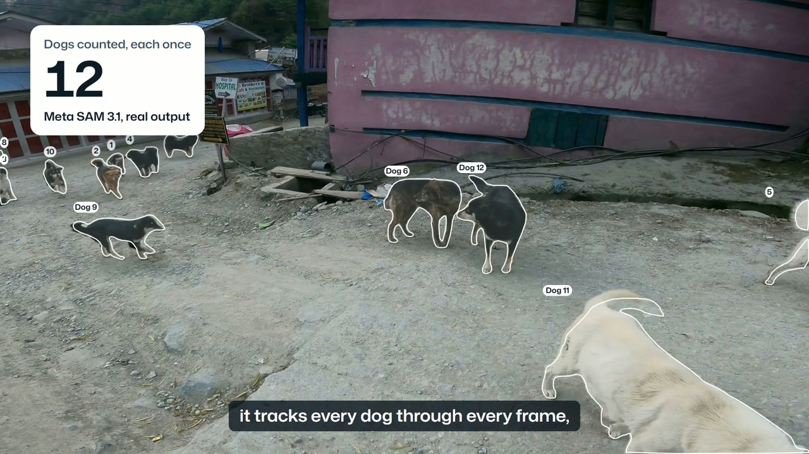
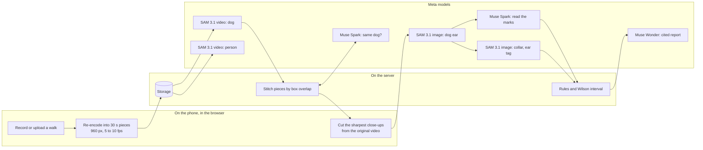

# Seventy

Rabies hides in the dogs a vaccination drive missed. Seventy finds them.

Seventy is a survey tool for rabies vaccination teams. A phone video goes through a multi-model pipeline (SAM 3.1, Muse Spark and Muse Wonder), and the rules that turn readings into a result live in plain, tested code, not in a prompt. It gives no medical advice.

[](https://github.com/omkydv/Seventy/actions/workflows/ci.yml)
[](LICENSE)
[](https://seventy-world.vercel.app)
[](https://youtu.be/MQQwoALKZkA)

| Submission | Meta Global AI Developer Hackathon 2026 |
|---|---|
| Track | Indie, theme Build for Your World |
| Built | From scratch, 28 October to 4 November 2026, inside the event, by one person. [Dated log](BUILD_LOG.md) |
| 3-minute film | [youtu.be/MQQwoALKZkA](https://youtu.be/MQQwoALKZkA) |
| Results | 28 of 28 dogs found on hand-counted videos, 100% precision and 97.5% recall in scored frames, about $2 a walk. [Scoring](eval/) |
| Meta models | SAM 3.1, Muse Spark and Muse Wonder, called live at runtime through the Meta Model API, in [seven jobs](#how-the-meta-models-are-used) |
| Try it live | [Run a sample walk](https://seventy-world.vercel.app/app/new): real Meta model calls on my API key, no login |
| Run it yourself | Add your `MODEL_API_KEY`, then `npm install` and `npm run dev`. [Steps](#run-it-yourself) |
| Bonus category | Best Creative Build: SAM 3.1's video tracking used as a street census, with SAM 3.1 and Muse Spark checking each other's readings |

<p align="center">
  <a href="https://youtu.be/MQQwoALKZkA"></a>
</p>
<p align="center"><a href="https://youtu.be/MQQwoALKZkA"><b>Watch the 3-minute film</b></a></p>

<p align="center">
  
</p>
<p align="center"><sub>Real SAM 3.1 output on a walk through a mountain village, drawn by Seventy's replay in the browser. Each dog keeps one number for as long as it is in view.</sub></p>

A surveyor films a street with any phone. Seventy counts every dog once, reads each dog's vaccination mark, and tells the team whether the street reached the 70% of dogs vaccinated that stops rabies. Then it shows where the unvaccinated dogs are, so the team goes back to those streets and no others. Every number on the page opens to the dogs behind it.

## Check it yourself in 60 seconds

Nothing to install. Each walk below has its answer written down before you run it. Open the link, press Start counting, and see if Seventy agrees. These are live calls to the real Meta models, on my API key, and the six-second walks take about a minute.

| Walk | Length | The answer to check | Run it | The clip |
|---|---:|---|---|---|
| Market street | 6 s | 4 dogs, counted by hand | [Run](https://seventy-world.vercel.app/app/new?sample=market-street) | [MP4](web/public/try/market-street.mp4) |
| City road | 6 s | 3 dogs, one of them 24 pixels tall | [Run](https://seventy-world.vercel.app/app/new?sample=city-road) | [MP4](web/public/try/road-walk.mp4) |
| Village lane | 16 s | 2 dogs, counted by hand | [Run](https://seventy-world.vercel.app/app/new?sample=village-lane) | [MP4](web/public/try/village-lane.mp4) |
| Rainy street | 9 s | 2 dogs, both wearing collars | [Run](https://seventy-world.vercel.app/app/new?sample=rainy-street) | [MP4](web/public/try/rainy-street.mp4) |

Or open a finished survey, which shows the stored output of a real run:

- [The mountain village square](https://seventy-world.vercel.app/app/demo). Press Play to watch SAM 3.1 count a pack of 13 dogs, each once, then open any dog.
- [The walk from the film](https://seventy-world.vercel.app/app/walks/20dc6230-bdc1-4ed0-adde-cb06688aad41), with the go-back map, the report and every model call. The camera was fed stock footage and the GPS route is simulated, and the page says so. The counts, readings, report and costs are real model output.

## What it is, and what it is not

Seventy is a coverage survey for teams that vaccinate or sterilize street dogs. It checks a drive. It doesn't run one.

- It gives no medical advice. It says nothing about bites or treatment, and it doesn't diagnose a dog or a person.
- It isn't a one-prompt image analyser. The count comes from video tracking across every frame, each reading from a fixed JSON schema, and every decision from plain, tested code.
- It doesn't track people. SAM 3.1 looks for people only to blur them. Nobody is counted, named or matched across walks.

## The problem

WHO counts 44,203 human rabies deaths a year. Four in ten are children, about 17,700 a year, and almost every case starts with a dog bite. Once symptoms begin it is almost always fatal, and every one of those deaths can be prevented with a vaccine ([WHO, 2026](https://www.who.int/news-room/fact-sheets/detail/rabies)).

The fix is known. Vaccinate 70% of the dogs in an area and the virus runs out of dogs to spread through ([WHO South-East Asia](https://www.who.int/southeastasia/health-topics/rabies)). WHO and its partners have set 2030 as the year human deaths from dog rabies should end ([Zero by 30](https://www.who.int/publications/m/item/zero-by-30-the-global-strategic-plan-to-prevent-humandeaths-from-dog-transmitted-rabies-by-2030)).

The weak step is checking. After a drive, surveyors walk the streets and tally marked and unmarked dogs on paper. The problems with that tally are well documented:

- One 2025 campaign, measured three standard ways, came out at 47%, 32% and 19% coverage ([Frontiers in Microbiology, 2025](https://www.frontiersin.org/journals/microbiology/articles/10.3389/fmicb.2025.1696281/full)).
- Street counts miss puppies, which are often too young to have been vaccinated, so coverage reads about 10% too high ([Frontiers in Veterinary Science, 2017](https://www.frontiersin.org/journals/veterinary-science/articles/10.3389/fvets.2017.00033/full)).
- Mark colours were often misread, and agreement between observers on them was low, a kappa of 0.27 ([Conan et al., 2015](https://pubmed.ncbi.nlm.nih.gov/26092723/)).
- The result is one number on a sheet. Nobody can check it afterwards.

So a drive that missed 70% looks exactly like one that reached it, until someone is bitten.

Cities already pay to solve the counting half of this. In October 2026 San Antonio's animal services commissioned an AI count of its roaming dogs, a roughly $99,000 deal, using phones mounted in vehicle windows. Its last volunteer study had observation sheets come back blank and couldn't produce a statistically reliable number ([KSAT](https://www.ksat.com/news/local/2026/10/28/researchers-use-cell-phones-and-ai-to-count-loose-dogs-in-san-antonio/), [Southwest Research Institute](https://www.swri.org/what-we-do/internal-research-development/2024/automotive-transportation/city-of-san-antonio-rd-league-computer-vision-unrestrained-dog-census-10-r633004)). Rabies programmes in Asia and Africa have the same question and a fraction of that budget. Seventy answers it, vaccination coverage included, from the walk their teams already make, for about $2 of model time.

## What one walk gives the team

| The team gets | How |
|---|---|
| Every dog counted once | SAM 3.1 tracks each dog through the video from the single word "dog". A long walk is split into pieces that overlap by two seconds and are joined by box overlap, so a dog crossing a boundary keeps its number. |
| Each dog's mark, read | SAM 3.1 finds and enlarges each dog's ears. Muse Spark reads paint, collars, ear tags and sterilization ear notches into fixed fields. For collars and ear tags, SAM 3.1 looks for the mark itself, and the two models have to agree. |
| Coverage with an honest margin | A Wilson 95% interval against the 70% line. Dogs too blurred to read are left out, never guessed. Below ten readable dogs, Seventy gives no percentage at all. |
| The doses to bring | From the count, before a drive starts. |
| Where to go back | A walk recorded in Seventy saves the phone's GPS route. Each dog sits on a map where it was first seen, the dogs still to vaccinate are grouped into places with walking directions, and the list goes to the team's chat in one tap. |
| A report for the office | Muse Wonder writes one page: the result, what to do tomorrow, and the WHO and national rules behind it, found by web search and cited. |
| Footage that is safe to share | Every person is pixelated inside their own SAM 3.1 outline, frame by frame. Nobody is counted or identified. |

<p align="center">
  
  
  
</p>
<p align="center"><sub>Real screens from the app on a phone: recording a walk with its route, the live screen while SAM 3.1 tracks two pieces at once, and a finished survey. The first two come from a test walk with a simulated GPS route.</sub></p>

## Measured results

Four street videos from four very different places, checked by hand. Every dog in each video was counted by hand, frame by frame on the original clip, then 28 frames were scored one dog at a time against SAM 3.1's boxes.

Seventy found all 28 dogs and counted each one once. Every one of the 159 boxes SAM 3.1 drew in the checked frames was on a real dog: 100% precision and 97.5% recall.

| Video | Place | Dogs by hand | Seventy | What makes it hard |
|---|---|---:|---:|---|
| Mountain village square | A mountain village at dusk, 20 s | 13 | 13 | A pack crossing the square around the camera |
| Seaside promenade | A seaside town, 22 s | 9 | 9 | A dark dog curled up far across the lawn, picked up in the last second |
| Market street | A city market, 6 s | 4 | 4 | Dogs close to the lens with a crowd behind them |
| Village lane | A village in the tropics, 16 s | 2 | 2 | Two dogs and a child walking past |
| Total | | 28 | 28 | |

| Video | Frames checked | Dog sightings | Boxed by SAM 3.1 | False alarms |
|---|---:|---:|---:|---:|
| Mountain village square | 11 | 89 | 89 | 0 |
| Seaside promenade | 9 | 50 | 46 | 0 |
| Market street | 4 | 16 | 16 | 0 |
| Village lane | 4 | 8 | 8 | 0 |
| All four | 28 | 163 | 159 | 0 |

The four sightings without a box are all the same dog, the one curled up dark against the promenade lawn, about 40 pixels long in a 1080 by 1920 frame. SAM 3.1 picks it up at 21.9 seconds, so it is counted. The hand labels, SAM's boxes, the scored frames and the scoring script are in [`eval/`](eval/), and CI scores them again on every push. You can [see every checked frame](web/public/eval/mountain-village.jpg) with SAM's boxes drawn on it.

Four things from the runs that show how it behaves:

- The dog we missed. We wrote two dogs on the City road clip. SAM 3.1 kept finding a third, so we looked at its close-ups: a real dog far down the road, 14 by 24 pixels. That clip isn't one of the four above, and you can [run it yourself](https://seventy-world.vercel.app/app/new?sample=city-road).
- Repeats. When a track started after another ended, Muse Spark compared the two dogs' close-ups. It checked 5 such pairs across the four videos and merged none, and the hand count agrees: no dog was counted twice.
- Two models disagreeing. On one mountain dog, SAM 3.1 took eyebrow spots for an ear tag. Muse Spark saw no tag. Under Seventy's rules neither answer counts for that dog, so one model's mistake can't become the result.
- The smallest mark. A municipal ear tag about 25 pixels across sits on a dog far down the promenade. SAM 3.1's enlarged ear makes it visible to a person. Muse Spark called the ear "too blurry to judge tag or notch", so the rules said can't tell and didn't guess. A person looked at the enlarged ear and marked the dog, and [its card](https://seventy-world.vercel.app/app/walks/887a06c9-3011-48c2-83ea-8ed9214ec3fe) shows both the reading and the person's decision.

## How the Meta models are used

Seven jobs for three models. The calls are from the mountain village walk: 20 seconds, 13 dogs.

| Model | Mode | Asked | Job | Calls | Without it |
|---|---|---|---|---:|---|
| SAM 3.1 | Video tracking | "dog" | Follows every dog through every frame. This is the count. | 1 job, 138 frames, 57.9 s | Dogs counted twice, or missed |
| SAM 3.1 | Video tracking | "person" | Finds people only to pixelate them inside their outline | 1 job, 20.1 s | Footage nobody should share |
| SAM 3.1 | Image segmentation | "dog ear" | Finds the ears on each dog's two best close-ups, enlarged for reading | 26 | Small tags and notches stay unreadable |
| Muse Spark | Vision, structured output | A fixed JSON schema | Reads paint, collar, ear tag, ear notch, puppy, lead, view quality, confidence and a reason | 13 | Marks read differently by every reader |
| SAM 3.1 | Image segmentation | "collar", "ear tag" | Looks for the mark itself, as a second opinion on Muse Spark | 26 | One model's mistake becomes the result |
| Muse Spark | Vision, comparison | Two dogs' close-ups | Same dog, different, or unsure, when a track starts after another ended | 3 | The same dog counted twice |
| Muse Wonder | Reasoning with web search | The walk's numbers | Writes the report, with the WHO and national rules it uses, cited | 1 | Numbers without a decision |

There is no mock mode. New walks always call the models, and finished surveys show the stored output of real runs.

The browser uses Meta's SAM client libraries too: `@meta-sam/parser` reads SAM's output, and `@meta-sam/graphics` and `@meta-sam/video` draw the outlines, numbers and blur on every frame of the replay.

## One dog, start to finish

Dog 4 from the market street walk, exactly as its record is stored.

<p>
  
  
  
</p>

1. SAM 3.1 tracked "dog" over all 62 frames of the walk and followed this dog from the first second to the last, with a mean confidence of 0.96. The three other dogs in the frame got their own numbers.
2. The browser went back to the original full-resolution video and cut the three sharpest views of Dog 4, at 0.7, 1.7 and 2.9 seconds, ranked by the variance of the Laplacian.
3. SAM 3.1 found "dog ear" on the two best close-ups, and Seventy enlarged both.
4. Muse Spark read the close-ups and ears in 7.3 seconds and returned this:

```json
{
  "is_dog": true,
  "paint": { "status": "absent", "color": null, "location": null },
  "collar": { "status": "absent", "color": null },
  "ear_tag": { "status": "absent", "color": null },
  "ear_notch": { "status": "absent", "side": null },
  "life_stage": "adult",
  "lead": { "status": "absent" },
  "coat": "tan with white lower legs chest and curled tail with white tip",
  "view_quality": "good",
  "confidence": 0.85,
  "reason": "Tan free-roaming dog with white legs shows no paint, collar, ear tag or ear notch in clear body views and ear close-ups."
}
```

5. SAM 3.1 looked for "collar" on the best close-up and "ear tag" on the enlarged ear, and found neither. The two models agree.
6. Seventy's rules: a good view, no mark, and two models in agreement, so Dog 4 is not marked. It counts against coverage, goes on the dose list, and on a recorded walk it goes on the map of where to go back.

The whole market walk, four dogs and a crowd blurred, cost $0.09 of model time.

## What runs where



The parts of the design that matter most:

- The phone does the heavy video work. [Mediabunny](https://mediabunny.dev) re-encodes the walk with WebCodecs into 30-second pieces at 960 px and 5 to 10 frames a second, so a minute of 1080p video uploads as about 5 to 9 MB. The original never leaves the phone, and the close-ups are cut from it later at full resolution.
- The server holds no long jobs. Each time the page checks in, the server moves the walk on by one short step: start SAM jobs, collect their output, stitch, read the next few dogs. The pieces of a long walk are tracked in parallel, and the live screen shows each one as it lands.
- Stitching (`web/src/lib/tracks.ts`): objects in each two-second overlap are matched by mean box IoU of 0.35 or more, best matches first. A track shorter than 0.6 seconds counts only when SAM's confidence is 0.6 or higher.
- The decisions live in plain, tested code, not in a prompt (`web/src/lib/marks.ts`, `web/src/lib/stats.ts`): the clear-view rule, two-model agreement, the Wilson interval, the ten-dog minimum, and doses as 70% of the count rounded up.
- Route maths (`web/src/lib/route.ts`): GPS fixes worse than 35 m, or that would mean moving faster than 4 m/s, are dropped. Each dog's position is interpolated at the second it was first seen. Places to go back to are dogs within 40 m of each other, grouped in walking order. On the map, pins that would overlap are clustered by distance on screen and regrouped at every zoom.
- Every model call is logged with its stage, frames or tokens, time and cost, so each survey shows what it cost. Daily spend caps, one per workspace and one for the whole public site, keep a demo from running up a bill.

All three models are called through the Meta Model API (`api.meta.ai`), from the server in `web/src/lib/server/` (`sam.ts`, `marks.ts`, `ears.ts`, `repeats.ts`, `report.ts`). Stack: Next.js 16 and React 19 on Vercel, Supabase for the database and storage, Mediabunny for video in the browser, MapLibre with OpenFreeMap tiles for the map.

## Cost and time

| One survey | Cost | Source |
|---|---:|---|
| San Antonio's AI count of one city's roaming dogs | about $99,000 | [KSAT](https://www.ksat.com/news/local/2026/10/28/researchers-use-cell-phones-and-ai-to-count-loose-dogs-in-san-antonio/) |
| A street transect survey, per village | $12.01 | [Frontiers in Veterinary Science, 2017](https://www.frontiersin.org/journals/veterinary-science/articles/10.3389/fvets.2017.00033/full) |
| Seventy, a ten-minute walk, model time | about $2 | The usage logs below |

The mountain village walk, from its usage log:

| Stage | Model | Calls | Model time | Cost |
|---|---|---:|---:|---:|
| Track every dog | SAM 3.1 | 1 job, 138 frames | 57.9 s | $0.028 |
| Find people to blur | SAM 3.1 | 1 job, 138 frames | 20.1 s | $0.028 |
| Find the ears | SAM 3.1 | 26 | | $0.065 |
| Read every mark | Muse Spark | 13, 27,464 tokens | 80.3 s | $0.067 |
| Second opinion on marks | SAM 3.1 | 26 | 23.5 s | $0.065 |
| Check for repeats | Muse Spark | 3, 2,952 tokens | 14.3 s | $0.008 |
| Write the report | Muse Wonder | 1, 17,629 tokens | | $0.121 |
| All stages | | 71 | | $0.38 |

All four sample videos together cost $0.65 before reports, and each report adds $0.12 to $0.55, depending on how much it searches. With the reports, the four surveys took 147 model calls. A ten-minute walk at five frames a second comes to about $2: $1.28 to track dogs and people, about $0.015 a dog for readings, and the report. SAM 3.1 tracked each sample in 30 to 75 seconds.

## Who uses it

| Team | Their question | What one walk gives them |
|---|---|---|
| Rabies vaccination programmes | Did this area reach 70%? | Coverage with an honest margin, every dog's mark as evidence, and a map of where the missed dogs are |
| Dog sterilization programmes | What share of the dogs here is sterilized? | The same walk read for the ear notch, with every unclear ear left out rather than guessed |
| City animal services | How many roaming dogs, and where? | Every dog counted once and placed along the route, with owned dogs on a lead set apart |

The same check scales from one surveyor on one morning, to every area of a city drive checked within three days, to every district of a country measured the same way, so a ministry or a funder can open any number and see the dogs behind it.

## Privacy and safety

- SAM 3.1 looks for people only to pixelate them inside their own outline, frame by frame. Nobody is counted, named or identified, and no person is matched across walks, in line with Meta's acceptable use policy.
- The original video stays on the phone. Only a low-frame-rate copy and the dogs' close-ups are uploaded.
- Seventy measures dog vaccination coverage for programme teams. It gives no medical advice.
- It never guesses. A dog too blurred to read is "can't tell" and is left out of the coverage. When the two models disagree, neither answer counts. With fewer than ten readable dogs there is no percentage. When a person settles a dog, the card shows the person's decision next to the models' reading.
- Location is saved only for walks recorded in Seventy, and it is the phone's own route.

## Run it yourself

You need Node 22 or later, Chrome or Edge, and a Meta Model API key. With no database settings, Seventy runs in local mode and keeps everything in `web/.local-data/` on your machine.

```bash
git clone https://github.com/omkydv/Seventy.git
cd Seventy/web
cp ../.env.example .env.local   # then put your key in MODEL_API_KEY
npm install
npm run dev                     # http://localhost:3000
```

Then open http://localhost:3000/app/new and pick a sample walk, upload any street video with dogs, or record a walk with the laptop's camera. The whole pipeline runs on your key. In a recorded walk, the browser's location becomes the route on the map. SAM 3.1 gets each piece of video as an upload, since it can't fetch links from your machine. Delete `web/.local-data/` to start again from the samples.

No key yet? http://localhost:3000/app still opens five finished surveys, showing the stored output of real model runs: every dog, its close-ups and readings, the replay, the report and the cost of each call. Counting a new walk needs the key, and the app says so.

Or with Docker, from the repository's root. CI builds this image and checks it on every push.

```bash
MODEL_API_KEY=your-key docker compose up --build     # http://localhost:3000
```

To run it the way the live site does, with Supabase for the database and storage, also set `NEXT_PUBLIC_SUPABASE_URL`, `NEXT_PUBLIC_SUPABASE_PUBLISHABLE_KEY` and `SUPABASE_SECRET_KEY`, and apply the SQL files in `supabase/migrations/` in order.

To prepare a walk offline and load it as a survey (needs Python 3.12, ffmpeg and Supabase):

```bash
bash services/worker/tools/prepare_sample.sh walk.mp4 out/walk 10
python services/worker/tools/reid.py out/walk
cd web && npx tsx scripts/seed-walk.ts ../out/walk --title "Village lane" --mode plan
```

### Tests

```bash
cd web
npm test              # statistics, mark rules, second opinions, track stitching, route maths
npm run lint
npm run typecheck
npm run build
cd ..
python eval/score.py                      # SAM 3.1 against the hand labels
node --test tests/smoke-local.test.mjs    # a fresh build: surveys, dogs, map, media
```

The 34 unit tests cover the counting, stitching, statistics, mark rules and route maths. CI runs all of this on every push, starts the Docker image, and fails if the published evaluation numbers drift from the labels.

## Repo map

- `web/` is the Next.js app.
  - `src/lib/server/` is the pipeline: SAM jobs, stitching, readings, second opinions, repeat checks, the report.
  - `src/lib/stats.ts` has the Wilson interval, coverage status and walk statistics.
  - `src/lib/tracks.ts` stitches tracks across pieces.
  - `src/lib/marks.ts` has the mark rules.
  - `src/lib/route.ts` has the GPS route maths.
  - `src/lib/client/video.ts` does the in-browser video work: probing, re-encoding pieces, cutting close-ups.
  - `src/app/app/new/RecordWalk.tsx` is the in-app recorder.
  - `src/components/WalkReplay.tsx` draws the replay, with labels and blur on every frame.
  - `src/components/WalkMap.tsx` draws the go-back map.
- `eval/` is the frame-by-frame check of SAM 3.1's boxes: hand labels, SAM's boxes and the scoring script.
- `tests/` starts a fresh build and checks the surveys open.
- `services/worker/` has Python tools for preparing sample walks offline.
- `supabase/migrations/` is the database schema.
- `Dockerfile` and `compose.yaml` run local mode in a container.
- [`BUILD_LOG.md`](BUILD_LOG.md) is the dated record of the build.

## What comes next

Uploading later when the signal comes back. The app in the languages surveyors speak. Team accounts, with a manager's laptop and five surveyors' phones on one programme. Every area's latest coverage on one district map. Two walks of the same route matched dog by dog for a population estimate. A field trial next to a standard survey, on the same streets, published in full.

## Sources

- [WHO rabies fact sheet, 2026](https://www.who.int/news-room/fact-sheets/detail/rabies)
- [WHO South-East Asia: rabies, and 70% dog vaccination coverage](https://www.who.int/southeastasia/health-topics/rabies)
- [Zero by 30: the global strategic plan to end human deaths from dog-mediated rabies by 2030](https://www.who.int/publications/m/item/zero-by-30-the-global-strategic-plan-to-prevent-humandeaths-from-dog-transmitted-rabies-by-2030)
- [Three ways to measure one campaign's coverage, Frontiers in Microbiology, 2025](https://www.frontiersin.org/journals/microbiology/articles/10.3389/fmicb.2025.1696281/full)
- [Comparing coverage surveys, and the puppies street counts miss, Frontiers in Veterinary Science, 2017](https://www.frontiersin.org/journals/veterinary-science/articles/10.3389/fvets.2017.00033/full)
- [Evaluation of methods for short-term marking of dogs for rabies control, Conan et al., 2015](https://pubmed.ncbi.nlm.nih.gov/26092723/)
- [San Antonio's AI count of loose dogs, KSAT, 28 October 2026](https://www.ksat.com/news/local/2026/10/28/researchers-use-cell-phones-and-ai-to-count-loose-dogs-in-san-antonio/)
- [The San Antonio unrestrained dog census, Southwest Research Institute](https://www.swri.org/what-we-do/internal-research-development/2024/automotive-transportation/city-of-san-antonio-rd-league-computer-vision-unrestrained-dog-census-10-r633004)

## Third-party code and assets

All of Seventy's code was written during the event; no code from earlier projects is included. It uses open-source libraries, listed in `web/package.json`: Next.js, React, the Supabase client, Mediabunny, MapLibre and Meta's `@meta-sam` packages. Map tiles come from OpenFreeMap, with data from OpenStreetMap contributors.

The street videos in this repository are from Pexels and used under the Pexels License. The photographs on the landing page are from Pexels and Unsplash, credited on the page. Every person in the replays is pixelated. The demo film also uses one clip from Pixabay, which isn't in this repository, and music and sound from Mixkit and Pixabay.

## License

The code is under the [MIT License](LICENSE). The street videos and photographs stay under their own licenses and aren't covered by it.
