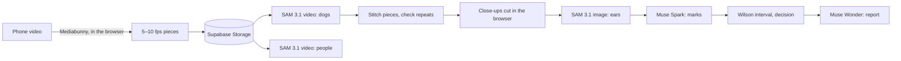

# Seventy

**Know when a street is safe from rabies.**

Walk a street with any phone. Seventy counts every dog once, reads each vaccination mark, and tells a vaccination team whether the area has reached the 70% that stops rabies. Every number comes with the evidence behind it: each dog's close-up, its moment in the walk, and what the model read.

Built for the Meta Global AI Developer Hackathon 2026 (Indie track, theme: Build for Your World). Every AI step runs on Meta models: SAM 3.1, Muse Spark and Muse Wonder.

## Why

- Rabies kills tens of thousands of people every year. Four in ten are children, and 99% of cases start with a dog ([WHO fact sheet, 2026](https://www.who.int/news-room/fact-sheets/detail/rabies)).
- Vaccinating 70% of dogs stops the virus spreading, and teams do that work every year, area by area.
- Checking whether a drive reached 70% is the weak step. One campaign measured three standard ways gave 47%, 32% and 19% ([Frontiers in Microbiology, 2025](https://www.frontiersin.org/journals/microbiology/articles/10.3389/fmicb.2025.1696281/full)).
- Street counts miss puppies and overstate coverage by about 10%, and local governments often have no budget to check at all ([Frontiers in Veterinary Science, 2017](https://www.frontiersin.org/journals/veterinary-science/articles/10.3389/fvets.2017.00033/full)).

An area wrongly marked complete is where rabies keeps moving. Seventy keeps the walk teams already do and turns it into evidence anyone can check.

Seventy measures dog vaccination for programme teams. It gives no medical advice to anyone.

## What it does

1. **Walk.** Film the street with any phone. The browser converts the video into small pieces (5–10 frames a second, 960 px) and uploads only those; the original stays on the phone.
2. **Count every dog once.** SAM 3.1 tracks every dog in each piece from the single word "dog". Pieces overlap by two seconds and are stitched by box overlap, so a dog crossing a boundary keeps one number.
3. **Check for repeats.** When a track starts after another ended, Muse Spark compares their close-ups and decides whether it is the same dog. Unsure pairs go to a person.
4. **Blur people.** SAM 3.1 looks for people only to pixelate them inside their own outline in every frame. Nobody is tracked, counted or identified.
5. **Read every mark.** The browser cuts the sharpest close-ups from the original video. SAM 3.1 finds the ears and enlarges them. Muse Spark reads paint, collars, ear tags and ear notches, notes puppies and dogs on a lead, and says "can't tell" when it can't. A person decides those.
6. **Decide with an honest margin.** Coverage comes with a Wilson 95% interval. Fewer than ten readable dogs is never called. The page says what to do next.
7. **Report.** Muse Wonder writes one page for the office, with the WHO and national rules it relies on found by web search and cited.

## Results (measured)

Four short street clips from four very different places, each counted by hand, frame by frame, without looking at Seventy's answer.

| Clip | Place | By hand | Seventy | What differed |
|---|---|---|---|---|
| Mountain village square | A mountain village at dusk, 20 s | 13 | 13 | Nothing |
| Seaside promenade | A seaside town, 22 s | 9 | 8 | Missed a dark dog lying flat on the lawn, far from the camera |
| Market street | A busy city market, 6 s | 4 | 4 | Nothing |
| Village lane | A village in the tropics, 16 s | 2 | 2 | Nothing |
| **Total** | | **28** | **27** | |

- **Ear tag.** One dog on the promenade carries a municipal ear tag about 25 pixels across. Muse Spark said it couldn't be sure; a person confirmed it in one look at SAM's enlarged ear.
- **Repeats.** Seventy checked 4 possible repeats and merged none. It left the unsure ones for a person, including one distant dog on the promenade that may have been seen twice.
- **Cost.** $0.53 for all four clips: tracking dogs and people, ear zoom, readings and repeat checks. A ten-minute walk costs about one dollar.
- **Time.** SAM 3.1 tracked each clip in 30–75 seconds; pieces of a long walk run in parallel.

Four short clips are a small test. The next one is a full ten-minute walk counted the same way by two people.

## Meta models

| Model | Job in Seventy |
|---|---|
| SAM 3.1, video | Tracks every dog through each piece of the walk; this is the count |
| SAM 3.1, video | Finds people, only to blur them |
| SAM 3.1, image | Finds the ears on each close-up so small tags and notches can be enlarged |
| Muse Spark 1.3 | Reads marks into fixed fields, notes puppies and leads, decides repeats, says "can't tell" |
| Muse Wonder 1.0 | Writes the cited report with web search |
| `@meta-sam/parser`, `@meta-sam/graphics`, `@meta-sam/video` | Decode SAM's output and draw outlines, numbers and blur on the video in the browser |

## How it is built



- `web/`: Next.js 16 app (App Router, React 19), Supabase for data and storage, Mediabunny for in-browser video conversion.
  - `src/lib/stats.ts`: Wilson intervals, coverage status, Chapman's estimator, walk statistics.
  - `src/lib/tracks.ts`: stitching tracks across pieces.
  - `src/lib/marks.ts`: mark rules.
  - `src/lib/server/`: the pipeline (jobs, polling, readings, report).
  - `src/components/WalkReplay.tsx`: the replay, with labels and blur drawn per frame.
- `worker/`: Python tools for preparing sample walks offline: split, track, stitch, read, re-identify, and draw boxes for checking by hand.
- `supabase/migrations/`: the database schema.

## Run it

Needs Node 22, Python 3.12 with ffmpeg on PATH (for the offline tools), a Supabase project and a Meta Model API key.

```bash
cd web
cp ../.env.example .env.local   # MODEL_API_KEY, NEXT_PUBLIC_SUPABASE_URL, NEXT_PUBLIC_SUPABASE_PUBLISHABLE_KEY, SUPABASE_SECRET_KEY
npm install
npm run dev
```

Apply the SQL in `supabase/migrations/` to the Supabase project, in order.

To prepare a sample walk offline and load it:

```bash
bash worker/tools/prepare_sample.sh walk.mp4 out/walk 10
python worker/tools/reid.py out/walk
cd web && npx tsx scripts/seed-walk.ts ../out/walk --title "Village lane" --mode plan
```

## Tests

```bash
cd web
npm test        # statistics, mark rules, track stitching
npm run lint
npm run typecheck
```

CI runs all three on every push.

## Footage and photographs

The street clips are from Pexels and used under the Pexels License. The photographs on the landing page are from Unsplash and used under the Unsplash License. No real people are tracked in any of them, and every person in the replays is blurred.

## Built during the hackathon

All code here was written between October 26 and November 4, 2026, by one person in a rural village, with a laptop and a phone.
